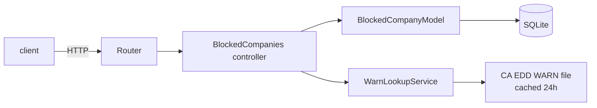

# Company Blocklist

[](https://github.com/Deshraj-Jogiya/company-blocklist/actions/workflows/ci.yml) 

A CodeIgniter 4 app for tracking companies to avoid in a job search, with bulk CSV import and a cross-check against California's public
WARN Act layoff notices.

## Highlights

- **Categorised entries:** reason, a bounded category (`layoffs`, `bad_reviews`, `no_sponsorship`, `other`) and the source (manual, CSV,
  WARN lookup), with a unique company name enforced by an `is_unique` rule.
- **Bulk CSV import:** every row goes through the same validation as a manual add; the response reports imported, skipped (duplicate) and
  rejected rows.
- **WARN Act check:** `GET /blocked-companies/warn-check?company=X` searches California EDD's public layoff file (cached for 24 hours) and
  returns matching notices for a person to review. Nothing is added automatically.
- **Feature tests** through the router, controller and model against a fresh SQLite database per test, including CSV uploads. Two
  CodeIgniter testing gotchas were found and fixed: `DatabaseTestTrait` defaulting to test-support fixtures only, and `assertJSONFragment`
  not matching inside list responses.

## Architecture



## Stack

PHP, CodeIgniter 4, SQLite, PHPUnit, GitHub Actions.

## Run it

```bash
composer install
php spark migrate
php spark serve
curl -X POST http://localhost:8080/blocked-companies -d "company_name=Acme Corp" -d "reason=Ghosted after onsite" -d "reason_category=bad_reviews"
curl "http://localhost:8080/blocked-companies/warn-check?company=Acme"
CI_ENVIRONMENT=testing ./vendor/bin/phpunit
```
